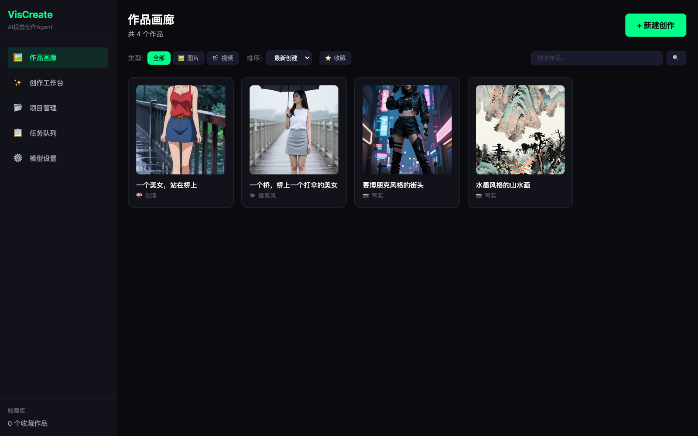
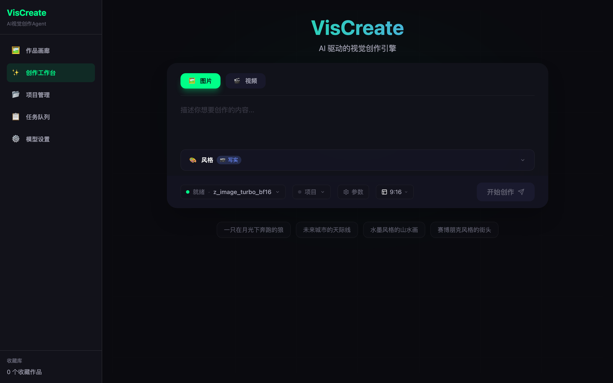
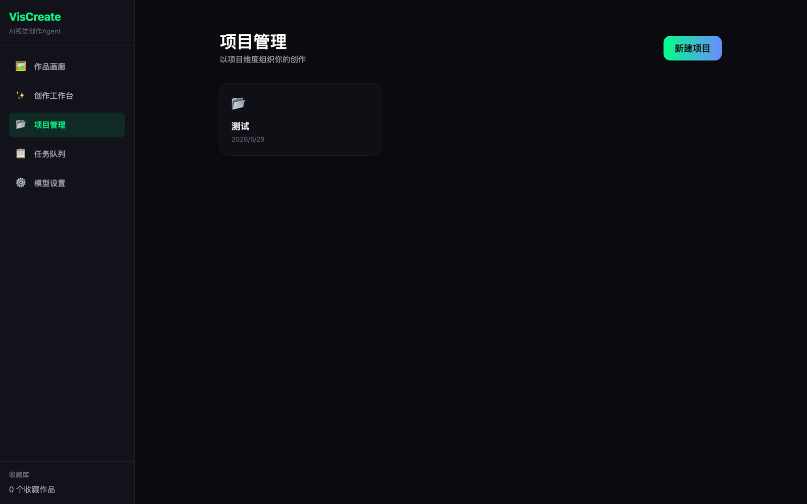
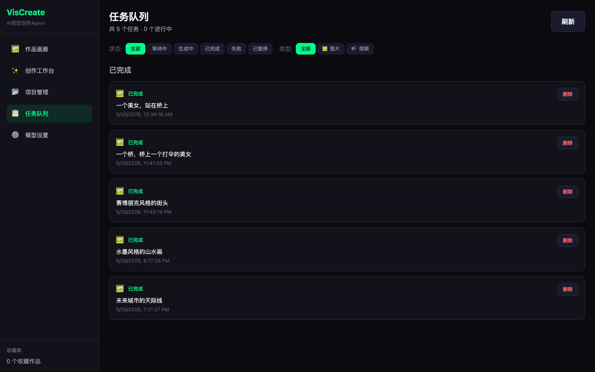
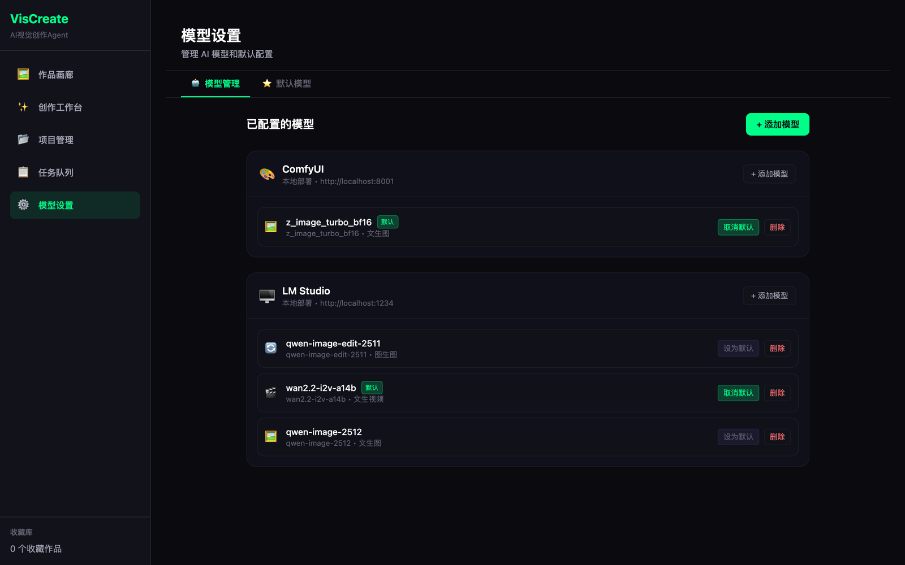

<div align="center">

# VisCreate

**AI Visual Creation Agent — a local-first desktop studio for AI image & video production.**

From a single prompt to a structured storyboard: generate, organise, and iterate on visual assets entirely on your own machine.

[](https://github.com/logic-cn/vis-create)
[](LICENSE)
[](pyproject.toml)
[](gui/src-tauri/Cargo.toml)
[](gui/package.json)
[](#project-status)

**English** · [简体中文](README.md)

</div>

---

## Screenshots

<table>
  <tr>
    <td width="50%"><br /><sub><b>Gallery</b> — browse, filter, search and favourite every generated asset.</sub></td>
    <td width="50%"><br /><sub><b>Creation workbench</b> — compose prompts with structured style / subject / environment parameters.</sub></td>
  </tr>
  <tr>
    <td width="50%"><br /><sub><b>Projects</b> — group assets by project, with characters, scripts and storyboards.</sub></td>
    <td width="50%"><br /><sub><b>Task queue</b> — real-time progress for every generation job, with pause / resume.</sub></td>
  </tr>
  <tr>
    <td colspan="2"><br /><sub><b>Model settings</b> — plug in local (ComfyUI, LM Studio, Ollama) or cloud providers and pick defaults per model type.</sub></td>
  </tr>
</table>

## Why VisCreate

Most AI image tools are either a web toy or a raw CLI. VisCreate is a **desktop application** that keeps your models, your prompts, your assets and your API keys on your own disk — while still giving you a structured, project-based workspace for real creative work.

- **Local-first.** Everything runs on `127.0.0.1`. Your prompts, generated media, and credentials never leave your machine except when you explicitly call a cloud model.
- **Structured prompting.** Instead of one flat text box, compose a shot from orthogonally-mapped parameters — style, subject, environment, photography, post-production, director — that are translated into model-ready English prompts.
- **Project workspace, not a folder.** Characters with locked avatars and reference images, scripts, chapters, scenes, and per-scene artwork generation keep long-form work coherent.
- **Any backend.** ComfyUI for local Stable Diffusion workflows, LM Studio / Ollama for local LLMs, OpenAI-compatible APIs and video services in the cloud.
- **Full task lifecycle.** Every generation is a task with progress events streamed over SSE, plus pause / resume / retry.

## Features

| Area | What it does |
| :--- | :--- |
| 🖼️ **Gallery** | Grid of all generated images & videos; filter by type, sort by date/name/favourite, keyword search, lightbox preview with the full parameter record of each artwork. |
| ✨ **Creation workbench** | Prompt + structured parameter panels, image/video modes, aspect-ratio presets, model selection, reference-image and character-consistency support. |
| 📂 **Projects** | Project-level organisation with assets, characters (avatar locking, reference images), scripts → chapters → scenes, and AI storyboard breakdown. |
| 📋 **Task queue** | Live status for every job (queued / running / completed / failed / paused), progress bars, SSE event stream, pause & resume. |
| ⚙️ **Model settings** | Register providers (ComfyUI, LM Studio, Ollama, or any custom OpenAI-compatible endpoint), manage models per provider, and set a default model for each capability (text-to-image, image-to-image, text-to-video, image-to-video, text generation). |
| 🤖 **Agent + CLI** | A LangChain-based agent and a `vis-create` CLI for scripted generation without the GUI. |
| 🎬 **Video generation** | Pluggable video backends (HappyHorse / Alibaba DashScope, Seedance / ByteDance Volcengine). |

## Architecture

```
┌──────────────────────────────────────────────┐
│  Tauri v2 desktop shell (Rust)               │
│  ┌────────────────────────────────────────┐  │
│  │  React 18 + TypeScript + Tailwind      │  │
│  │  Zustand stores · React Query · Router │  │
│  └────────────────┬───────────────────────┘  │
└───────────────────┼──────────────────────────┘
                    │ HTTP + SSE  (localhost:8000)
┌───────────────────▼──────────────────────────┐
│  FastAPI backend (Python 3.11+)              │
│  ┌──────────────┬───────────────┬─────────┐  │
│  │ REST routers │ Task engine   │ Agent   │  │
│  │ (artworks,   │ (async jobs,  │ (Lang-  │  │
│  │  projects,   │  SSE events)  │  Chain) │  │
│  │  tasks, ...) │               │         │  │
│  └──────┬───────┴───────┬───────┴────┬────┘  │
│         │               │            │       │
│  ┌──────▼──────┐ ┌──────▼──────┐ ┌───▼────┐  │
│  │ PostgreSQL  │ │  MinIO /    │ │ Model  │  │
│  │ (metadata)  │ │  local FS   │ │ back-  │  │
│  │             │ │  (assets)   │ │ ends   │  │
│  └─────────────┘ └─────────────┘ └────────┘  │
└──────────────────────────────────────────────┘
```

- **Backend** — FastAPI + SQLAlchemy 2.x + Pydantic v2. 37 paths / 63 operations, SSE task stream, async generators for image/video providers.
- **Frontend** — React 18 + TypeScript + Tailwind CSS, Zustand for state, TanStack Query for fetching, packaged with Tauri v2.
- **Storage** — PostgreSQL for structured metadata (deliberately **no foreign keys** — referential integrity is handled in the application layer), MinIO or the local filesystem for media.

## Quick start

### Prerequisites

| Requirement | Version | Notes |
| :--- | :--- | :--- |
| Python | 3.11+ | Backend |
| Node.js | 18+ | Frontend / Tauri |
| Rust | stable | Only needed to build the desktop shell |
| PostgreSQL | 14+ | Metadata store |
| MinIO | optional | Object storage; a local `./output` folder works too |
| ComfyUI / LM Studio / Ollama | optional | Local model backends |

### 1 — Backend

```bash
git clone https://github.com/logic-cn/vis-create.git
cd vis-create

# Install (uv recommended)
uv venv && source .venv/bin/activate
uv pip install -e ".[dev]"

# Configure
cp .env.example .env
# edit .env → at minimum DB_* values

# Create tables
python scripts/init_db.py

# Run
uvicorn vis_create.app:app --reload      # http://127.0.0.1:8000
```

The interactive API docs are at <http://127.0.0.1:8000/docs>.

### 2 — Desktop app

```bash
cd gui
npm install
npm run tauri dev        # launches the desktop window
```

For frontend-only development against a running backend:

```bash
cd gui && npm run dev    # http://localhost:1420
```

### 3 — Build a release bundle

```bash
cd gui
npm run tauri build      # → gui/src-tauri/target/release/bundle/
```

Bundles are produced for the current platform (`.dmg` / `.app` on macOS, `.msi` / `.exe` on Windows, `.deb` / `.AppImage` on Linux).

## Configuration

All configuration lives in `.env` (never committed). Copy `.env.example` to get started.

| Variable | Required | Default | Description |
| :--- | :---: | :--- | :--- |
| `DB_HOST` / `DB_PORT` | ✅ | `localhost` / `5432` | PostgreSQL host and port |
| `DB_NAME` / `DB_USER` / `DB_PASSWORD` | ✅ | `vis-create` / `postgres` / — | PostgreSQL database and credentials |
| `OPENAI_API_KEY` | — | — | OpenAI (or OpenAI-compatible) key for agent & text models |
| `OPENAI_MODEL` | — | `gpt-4-turbo-preview` | Default chat model |
| `VIDEO_PROVIDER` | — | `happyhorse` | `happyhorse` (DashScope) or `seedance` (Volcengine) |
| `VIDEO_API_KEY` | — | — | Key for the selected video backend |
| `VIDEO_API_ENDPOINT` | — | provider default | Override the video API base URL |
| `STABILITY_API_KEY` | — | — | Stable Diffusion API (optional) |
| `MINIO_ENDPOINT` / `MINIO_ACCESS_KEY` / `MINIO_SECRET_KEY` / `MINIO_BUCKET` | — | `127.0.0.1:9000` / `minioadmin` / `minioadmin` / `vis-create` | Object storage |
| `OUTPUT_DIR` | — | `./output` | Local media output directory |
| `LOG_LEVEL` / `VERBOSE` | — | `INFO` / `false` | Logging |

> **Security note:** API keys are stored server-side and are **never** returned in plaintext by the REST API — write endpoints accept them, read endpoints return a masked value. See [SECURITY.md](SECURITY.md).

## CLI usage

```bash
vis-create --version
vis-create generate "a cat sleeping in a garden" --style anime --size 1024x1024
vis-create video "timelapse of a sunset beach"
```

## API overview

| Group | Base path | Endpoints |
| :--- | :--- | :--- |
| Artworks | `/api/artworks` | CRUD, favourite toggle |
| Projects | `/api/projects` | CRUD, assets, characters (avatar / reference images), scripts, chapters, scenes, AI breakdown, per-scene artwork |
| Tasks | `/api/tasks` | CRUD, create / edit, pause / resume, SSE event stream |
| Settings | `/api/settings` | Read / update, provider connectivity test |
| Model settings | `/api/model-settings` | Providers CRUD, models CRUD, per-capability defaults |
| Health | `/health` | Liveness probe |

## Project structure

```
vis-create/
├── src/vis_create/          # Python backend
│   ├── app.py               #   FastAPI application
│   ├── main.py              #   CLI entry point (Typer)
│   ├── api/                 #   REST routers
│   ├── agent/               #   LangChain agent core & tools
│   ├── generators/          #   Image / video / ComfyUI generators
│   ├── models/              #   SQLAlchemy models
│   ├── services/            #   Storage (MinIO / local FS)
│   ├── prompts/             #   Parameter → prompt translation
│   ├── handlers/            #   File / image / video handlers
│   ├── database/            #   Engine & session management
│   └── config/              #   Pydantic settings
├── gui/                     # Desktop app
│   ├── src/
│   │   ├── pages/           #   Gallery, Creator, Projects, Tasks, Settings
│   │   ├── components/      #   Layout, gallery, project, task UI
│   │   ├── stores/          #   Zustand stores
│   │   ├── services/        #   API clients
│   │   ├── types/           #   TypeScript contracts
│   │   └── constants/       #   Creation parameter definitions
│   └── src-tauri/           #   Tauri v2 shell (Rust)
├── scripts/                 # DB init & connection tests
├── tests/                   # pytest suite
├── docs/screenshots/        # README images
├── pyproject.toml
└── .env.example
```

## Development

```bash
# Backend
pytest tests/ -v            # tests
ruff format src/            # format
ruff check src/             # lint
mypy src/                   # type check

# Frontend
cd gui
npx tsc --noEmit            # type check
npm run build               # production build
npx prettier --write .      # format
```

## Project status

VisCreate is at **v0.1.0 (alpha)**. The vertical slice — generate → organise → iterate — works end to end and is exercised against real local models.

**Working today**

- Image generation through ComfyUI, with structured parameter → prompt translation
- Task queue with SSE progress, pause/resume, deletion
- Artwork gallery with filtering, sorting, search and favourites
- Project workspace: assets, characters (avatar locking, reference images), scripts → chapters → scenes, AI storyboard breakdown, per-scene artwork generation
- Multi-provider model management with per-capability defaults
- Video generation against DashScope / Volcengine backends
- Tauri desktop packaging for macOS / Windows / Linux

**Known gaps / next up**

- Test coverage is still thin (currently focused on the prompt builder and agent); API and task-engine integration tests are the priority
- No CI pipeline or release automation yet
- No database migration tooling wired up (schema is created from `scripts/init_db.py`)
- The UI is currently Chinese-only; internationalisation is planned
- Windows / Linux bundles are untested on real hardware

## Contributing

Issues and pull requests are welcome. Please:

1. Fork the repo and create a topic branch.
2. Keep the diff focused; run `pytest`, `ruff format`, and `npx tsc --noEmit` before opening a PR.
3. Do not commit `.env` files, API keys, generated media, or build artefacts.

## Security

Please report vulnerabilities privately — see [SECURITY.md](SECURITY.md). Never open a public issue containing a live API key.

## License

[MIT](LICENSE) © logic-cn
