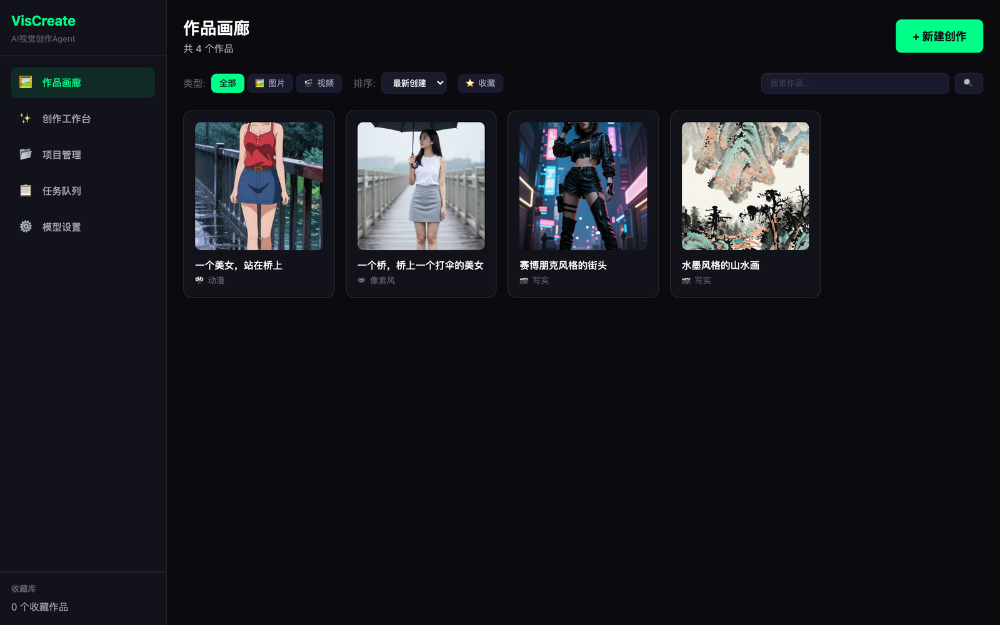
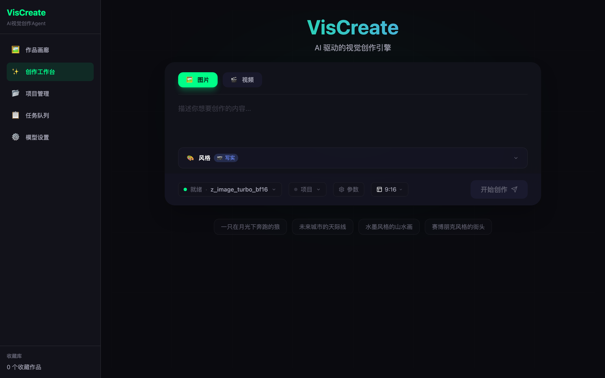
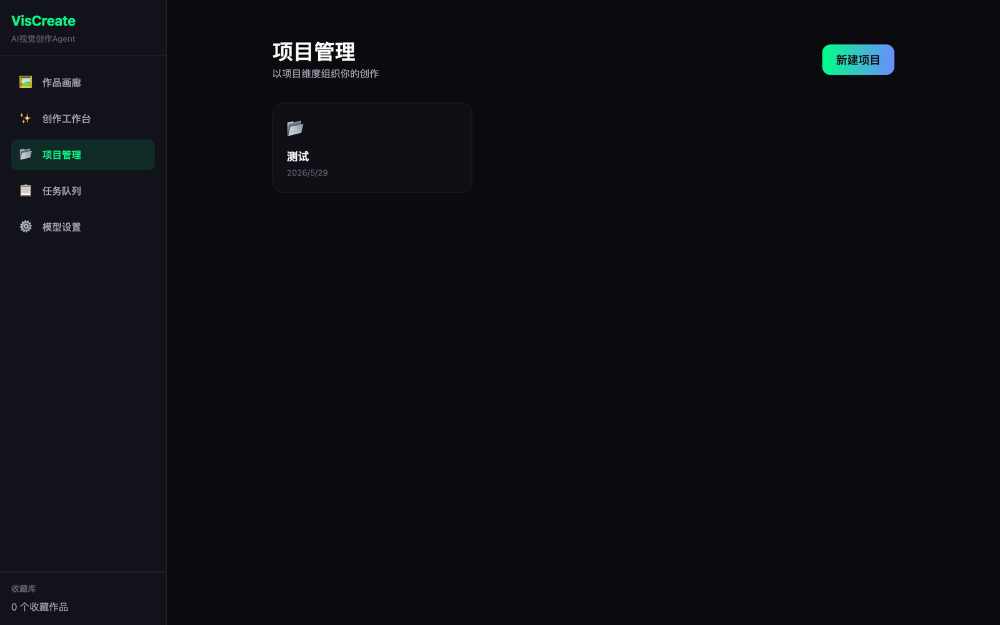
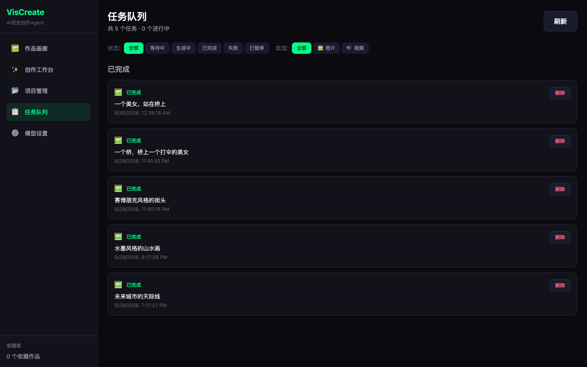
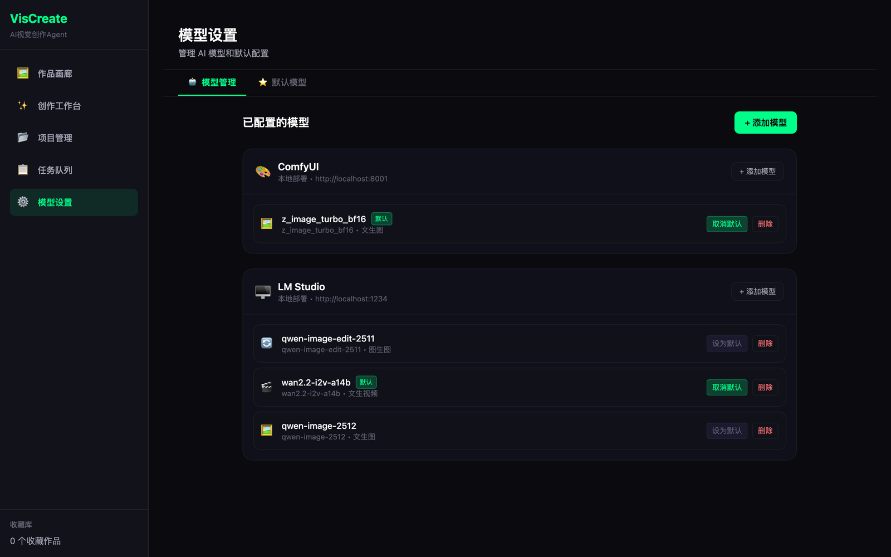

<div align="center">

# VisCreate

**AI 视觉创作 Agent —— 本地优先的桌面级 AI 图片 / 视频创作工作台。**

从一句话到结构化分镜：在你自己的机器上完成生成、管理与迭代。

[](https://github.com/logic-cn/vis-create)
[](LICENSE)
[](pyproject.toml)
[](gui/src-tauri/Cargo.toml)
[](gui/package.json)
[](#项目状态)

[English](README.en.md) · **简体中文**

</div>

---

## 界面截图

<table>
  <tr>
    <td width="50%"><br /><sub><b>作品画廊</b> —— 浏览、筛选、搜索并收藏所有生成素材。</sub></td>
    <td width="50%"><br /><sub><b>创作工作台</b> —— 用结构化的风格 / 主体 / 环境参数组合提示词。</sub></td>
  </tr>
  <tr>
    <td width="50%"><br /><sub><b>项目管理</b> —— 以项目为单位组织素材，管理角色、剧本与分镜。</sub></td>
    <td width="50%"><br /><sub><b>任务队列</b> —— 实时查看每个生成任务的进度，支持暂停 / 恢复。</sub></td>
  </tr>
  <tr>
    <td colspan="2"><br /><sub><b>模型设置</b> —— 接入本地（ComfyUI、LM Studio、Ollama）或云端供应商，并为每种能力指定默认模型。</sub></td>
  </tr>
</table>

## 为什么选 VisCreate

AI 绘图工具要么是网页玩具，要么是裸奔的命令行。VisCreate 是一个**桌面应用**：你的模型、提示词、素材和 API 密钥都留在自己的磁盘上，同时又有结构化、项目化的创作工作区。

- **本地优先** —— 所有服务都跑在 `127.0.0.1`。除非你主动调用云端模型，提示词、生成素材与凭据都不离开你的机器。
- **结构化提示词** —— 不是一个大文本框，而是用相互正交的参数（风格、主体、环境、摄影、后期、导演）组合镜头，自动翻译成模型友好的英文提示词。
- **项目化工作区，而不是一个文件夹** —— 带锁定头像与参考图的角色、剧本、章节、场景，以及逐场景出图，让长篇创作保持连贯。
- **后端开放** —— 本地 Stable Diffusion 走 ComfyUI；本地大模型走 LM Studio / Ollama；云端接 OpenAI 兼容接口与视频服务。
- **完整任务生命周期** —— 每次生成都是一个任务，通过 SSE 推送进度，支持暂停、恢复、重试。

## 功能特性

| 模块 | 能力 |
| :--- | :--- |
| 🖼️ **作品画廊** | 全部图片与视频的宫格视图；按类型筛选、按时间/名称/收藏排序、关键词搜索；灯箱预览可查看每件作品的完整参数记录。 |
| ✨ **创作工作台** | 提示词 + 结构化参数面板、图片/视频模式、画幅预设、模型选择、参考图与角色一致性支持。 |
| 📂 **项目管理** | 项目级组织：素材、角色（头像锁定、参考图）、剧本 → 章节 → 场景，以及 AI 自动拆解分镜。 |
| 📋 **任务队列** | 每个任务实时状态（等待中/生成中/已完成/失败/已暂停）、进度条、SSE 事件流、暂停与恢复。 |
| ⚙️ **模型设置** | 注册供应商（ComfyUI、LM Studio、Ollama 或任意 OpenAI 兼容端点）、按供应商管理模型、为每种能力（文生图、图生图、文生视频、图生视频、文本生成）设定默认模型。 |
| 🤖 **Agent + CLI** | 基于 LangChain 的 Agent，以及 `vis-create` 命令行工具，可不启动 GUI 直接生成。 |
| 🎬 **视频生成** | 可插拔的视频后端（HappyHorse / 阿里云百炼 DashScope、Seedance / 字节跳动火山引擎）。 |

## 架构

```
┌──────────────────────────────────────────────┐
│  Tauri v2 桌面外壳 (Rust)                     │
│  ┌────────────────────────────────────────┐  │
│  │  React 18 + TypeScript + Tailwind      │  │
│  │  Zustand 状态 · React Query · Router   │  │
│  └────────────────┬───────────────────────┘  │
└───────────────────┼──────────────────────────┘
                    │ HTTP + SSE  (localhost:8000)
┌───────────────────▼──────────────────────────┐
│  FastAPI 后端 (Python 3.11+)                 │
│  ┌──────────────┬───────────────┬─────────┐  │
│  │ REST 路由    │ 任务引擎       │ Agent   │  │
│  │ (作品、项目、│ (异步任务、    │ (Lang-  │  │
│  │  任务…)      │  SSE 事件)     │  Chain) │  │
│  └──────┬───────┴───────┬───────┴────┬────┘  │
│         │               │            │       │
│  ┌──────▼──────┐ ┌──────▼──────┐ ┌───▼────┐  │
│  │ PostgreSQL  │ │  MinIO /    │ │ 模型   │  │
│  │ (元数据)    │ │  本地文件   │ │ 后端   │  │
│  │             │ │  (素材)     │ │        │  │
│  └─────────────┘ └─────────────┘ └────────┘  │
└──────────────────────────────────────────────┘
```

- **后端** —— FastAPI + SQLAlchemy 2.x + Pydantic v2。37 个路径、63 个 REST 操作、SSE 任务流、图片/视频供应商的异步生成器。
- **前端** —— React 18 + TypeScript + Tailwind CSS，Zustand 管理状态，TanStack Query 负责请求，Tauri v2 打包成桌面应用。
- **存储** —— PostgreSQL 存结构化元数据（**刻意不使用外键**，引用完整性由应用层保证），MinIO 或本地文件系统存媒体。

## 快速开始

### 环境要求

| 依赖 | 版本 | 说明 |
| :--- | :--- | :--- |
| Python | 3.11+ | 后端 |
| Node.js | 18+ | 前端 / Tauri |
| Rust | stable | 仅在构建桌面外壳时需要 |
| PostgreSQL | 14+ | 元数据存储 |
| MinIO | 可选 | 对象存储；用本地 `./output` 目录也可以 |
| ComfyUI / LM Studio / Ollama | 可选 | 本地模型后端 |

### 1 —— 启动后端

```bash
git clone https://github.com/logic-cn/vis-create.git
cd vis-create

# 安装（推荐 uv）
uv venv && source .venv/bin/activate
uv pip install -e ".[dev]"

# 配置
cp .env.example .env
# 编辑 .env → 至少填写 DB_* 相关项

# 建表
python scripts/init_db.py

# 启动
uvicorn vis_create.app:app --reload      # http://127.0.0.1:8000
```

交互式 API 文档：<http://127.0.0.1:8000/docs>。

### 2 —— 启动桌面应用

```bash
cd gui
npm install
npm run tauri dev        # 打开桌面窗口
```

只想调前端（后端已在运行）：

```bash
cd gui && npm run dev    # http://localhost:1420
```

### 3 —— 构建安装包

```bash
cd gui
npm run tauri build      # → gui/src-tauri/target/release/bundle/
```

会为当前平台产出安装包（macOS 为 `.dmg` / `.app`，Windows 为 `.msi` / `.exe`，Linux 为 `.deb` / `.AppImage`）。

## 配置项

所有配置都放在 `.env`（永不提交）。从 `.env.example` 复制即可开始。

| 变量 | 必需 | 默认值 | 说明 |
| :--- | :---: | :--- | :--- |
| `DB_HOST` / `DB_PORT` | ✅ | `localhost` / `5432` | PostgreSQL 主机与端口 |
| `DB_NAME` / `DB_USER` / `DB_PASSWORD` | ✅ | `vis-create` / `postgres` / — | PostgreSQL 库名与凭据 |
| `OPENAI_API_KEY` | — | — | OpenAI（或兼容接口）密钥，供 Agent 与文本模型使用 |
| `OPENAI_MODEL` | — | `gpt-4-turbo-preview` | 默认对话模型 |
| `VIDEO_PROVIDER` | — | `happyhorse` | `happyhorse`（百炼）或 `seedance`（火山引擎） |
| `VIDEO_API_KEY` | — | — | 所选视频后端的密钥 |
| `VIDEO_API_ENDPOINT` | — | 供应商默认 | 覆盖视频 API 地址 |
| `STABILITY_API_KEY` | — | — | Stable Diffusion API（可选） |
| `MINIO_ENDPOINT` / `MINIO_ACCESS_KEY` / `MINIO_SECRET_KEY` / `MINIO_BUCKET` | — | `127.0.0.1:9000` / `minioadmin` / `minioadmin` / `vis-create` | 对象存储 |
| `OUTPUT_DIR` | — | `./output` | 本地媒体输出目录 |
| `LOG_LEVEL` / `VERBOSE` | — | `INFO` / `false` | 日志 |

> **安全提示：** API 密钥保存在服务端，REST API **绝不会**以明文回传 —— 写入接口接受密钥，读取接口只返回脱敏值。详见 [SECURITY.md](SECURITY.md)。

## CLI 用法

```bash
vis-create --version
vis-create generate "一只在花园里睡觉的猫" --style anime --size 1024x1024
vis-create video "日落海滩的延时摄影"
```

## API 概览

| 分组 | 基础路径 | 端点 |
| :--- | :--- | :--- |
| 作品 | `/api/artworks` | CRUD、收藏切换 |
| 项目 | `/api/projects` | CRUD、素材、角色（头像 / 参考图）、剧本、章节、场景、AI 拆解、逐场景出图 |
| 任务 | `/api/tasks` | CRUD、创建 / 编辑、暂停 / 恢复、SSE 事件流 |
| 设置 | `/api/settings` | 读取 / 更新、供应商连通性测试 |
| 模型设置 | `/api/model-settings` | 供应商 CRUD、模型 CRUD、按能力设默认 |
| 健康检查 | `/health` | 存活探针 |

## 项目结构

```
vis-create/
├── src/vis_create/          # Python 后端
│   ├── app.py               #   FastAPI 应用
│   ├── main.py              #   CLI 入口（Typer）
│   ├── api/                 #   REST 路由
│   ├── agent/               #   LangChain Agent 核心与工具
│   ├── generators/          #   图片 / 视频 / ComfyUI 生成器
│   ├── models/              #   SQLAlchemy 模型
│   ├── services/            #   存储（MinIO / 本地文件）
│   ├── prompts/             #   参数 → 提示词翻译
│   ├── handlers/            #   文件 / 图片 / 视频处理器
│   ├── database/            #   引擎与会话管理
│   └── config/              #   Pydantic 配置
├── gui/                     # 桌面应用
│   ├── src/
│   │   ├── pages/           #   画廊、创作、项目、任务、设置
│   │   ├── components/      #   布局、画廊、项目、任务 UI
│   │   ├── stores/          #   Zustand 状态
│   │   ├── services/        #   API 客户端
│   │   ├── types/           #   TypeScript 类型契约
│   │   └── constants/       #   创作参数定义
│   └── src-tauri/           #   Tauri v2 外壳（Rust）
├── scripts/                 # 建表与连接测试脚本
├── tests/                   # pytest 测试
├── docs/screenshots/        # README 配图
├── pyproject.toml
└── .env.example
```

## 开发

```bash
# 后端
pytest tests/ -v            # 测试
ruff format src/            # 格式化
ruff check src/             # 静态检查
mypy src/                   # 类型检查

# 前端
cd gui
npx tsc --noEmit            # 类型检查
npm run build               # 生产构建
npx prettier --write .      # 格式化
```

## 项目状态

VisCreate 处于 **v0.1.0（alpha）** 阶段。核心闭环 —— 生成 → 组织 → 迭代 —— 已经端到端可用，并在真实本地模型上验证过。

**当前可用**

- 通过 ComfyUI 出图，含结构化参数 → 提示词翻译
- 任务队列：SSE 进度、暂停/恢复、删除
- 作品画廊：筛选、排序、搜索与收藏
- 项目工作区：素材、角色（头像锁定、参考图）、剧本 → 章节 → 场景、AI 自动拆解分镜、逐场景出图
- 多供应商模型管理，按能力设默认
- 对接百炼 / 火山引擎的视频生成
- macOS / Windows / Linux 的 Tauri 桌面打包

**已知不足 / 后续计划**

- 测试覆盖仍然偏薄（目前集中在提示词构建器与 Agent），API 与任务引擎的集成测试是首要任务
- 尚无 CI 流水线与自动发布
- 尚未接入数据库迁移工具（表结构由 `scripts/init_db.py` 创建）
- 界面目前仅中文，国际化在计划中
- Windows / Linux 安装包尚未在真机验证

## 参与贡献

欢迎提 Issue 和 PR。请：

1. Fork 仓库并切出主题分支。
2. 保持改动聚焦；提交 PR 前跑通 `pytest`、`ruff format` 与 `npx tsc --noEmit`。
3. 不要提交 `.env`、API 密钥、生成素材或构建产物。

## 安全

请通过私下渠道报告漏洞 —— 见 [SECURITY.md](SECURITY.md)。切勿在公开 Issue 中粘贴真实 API 密钥。

## 许可证

[MIT](LICENSE) © logic-cn
